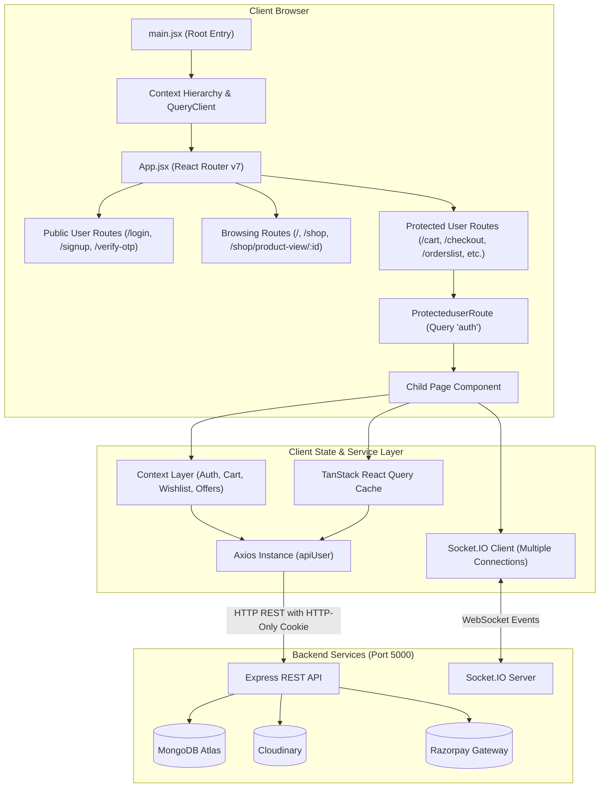
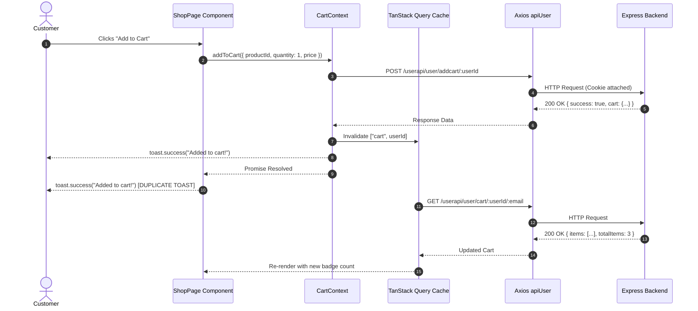

# Wotix Frontend Codebase Audit & Architectural Analysis

**Document Version:** 1.0.0  
**Date:** October 22, 2026  
**Auditor:** Senior Frontend Engineer & Software Architect  
**Scope:** Client-side React Application (`/Frontend`)  
**Target Reference:** Customer-Facing UI/UX Modernization & Stabilization

---

## 1. Executive Summary

This audit delivers an exhaustive architectural, structural, and quality analysis of the **Wotix e-commerce frontend**. The primary objective of the upcoming project phase is to **modernize and polish the customer-facing UI/UX** while **preserving existing backend integrations, business logic, and API contracts**.

### Key Audit Conclusions

1. **Working Foundation with Critical Stability Traps:**  
   The application possesses functional, end-to-end e-commerce features (browsing, cart, checkout, Razorpay payments, wallet balances, return requests, and real-time Socket.IO notifications). However, several **P0 (Critical)** functional bugs block essential user journeys:
   - **Broken Signup Navigation:** After submitting the registration form, users are redirected to `/otp` which is not mapped in the router, triggering a 404 page and halting new user acquisition.
   - **Destructive Payment Failure Logic:** In `/checkout`, if Razorpay encounters an error or fails to load, client-side code wipes the user's cart (`clearCart()`), destroying order intent and causing immediate cart abandonment.
   - **Literal Parameter Corruption in Routes:** Profile and Edit Profile routes include literal `":id"` strings in URL paths (e.g., `/profile/:id/edit-profile/${id}`), leading to URL path malformations.

2. **Framework & Library Version Incompatibilities:**  
   The project runs **React 19.0.0** and **TanStack Query v5.69.0**, but much of the codebase was authored using **TanStack Query v4** syntax:
   - Direct array arguments in `queryClient.invalidateQueries(["cart", userId])` instead of the v5 object syntax `{ queryKey: [...] }`.
   - References to `.isLoading` on mutations (which is `undefined` in v5; replaced by `.isPending`), preventing button disabled states and loading spinners from rendering.
   - Deprecated `keepPreviousData: true` and `cacheTime` arguments.
   - Query callbacks `onError` inside `useQuery` (removed in v5) that never fire.

3. **Duplicated Code & State Management Redundancy:**  
   Multiple duplicate components exist across directories (e.g., `addressForms.jsx` vs `addressForm.jsx`, `emalinput.jsx` vs `forgot.jsx`, `cartOffer.jsx` vs `offerprice.jsx`, `wishlistContext.jsx` vs `wishlistCount.jsx`). Redundant Context Providers wrap the app and query the exact same backend endpoints concurrently.

4. **UI/UX Fragmentation & Layout Fragility:**  
   The visual design lacks consistent design tokens, unified typography, and component cohesion:
   - Header is fragmented into two stacked rows (`IconsArea` on top with an oversized 150px logo, followed by a separate `Navbar` strip), consuming excessive vertical screen space before any product content is visible.
   - Buttons oscillate arbitrarily between solid black, royal blue (`bg-blue-600`), and indigo (`bg-indigo-600`).
   - Brittle layout styling (e.g., negative margins like `-ml-50`, fixed-width containers like `w-400`, fixed dimensions on image magnifiers like `400px` by `400px`, and arbitrary positioning like `left-124`) breaks responsiveness on mobile viewports.
   - Search queries and filter parameters are not synchronized to URL query parameters (`searchParams`), losing state on refresh or navigation.

---

## 2. Audit Scope and Limitations

### In-Scope
- Static analysis of all files in [`Frontend/src`](file:///c:/Users/DELL/Desktop/Wotix-ecomerce/Frontend/src).
- Routing, layouts, and public/protected route guards in [`Frontend/src/App.jsx`](file:///c:/Users/DELL/Desktop/Wotix-ecomerce/Frontend/src/App.jsx).
- State management across all Context Providers in [`Frontend/src/context`](file:///c:/Users/DELL/Desktop/Wotix-ecomerce/Frontend/src/context).
- Client API modules in [`Frontend/src/api`](file:///c:/Users/DELL/Desktop/Wotix-ecomerce/Frontend/src/api) and correlation with [`Backend/routes`](file:///c:/Users/DELL/Desktop/Wotix-ecomerce/Backend/routes).
- All 12 customer-facing page modules in [`Frontend/src/components/users/userPages`](file:///c:/Users/DELL/Desktop/Wotix-ecomerce/Frontend/src/components/users/userPages).
- Shared and UI primitives in [`Frontend/src/components/common`](file:///c:/Users/DELL/Desktop/Wotix-ecomerce/Frontend/src/components/common) and [`Frontend/src/components/ui`](file:///c:/Users/DELL/Desktop/Wotix-ecomerce/Frontend/src/components/ui).
- Real-time WebSocket connection handling in [`Frontend/src/Sockets`](file:///c:/Users/DELL/Desktop/Wotix-ecomerce/Frontend/src/Sockets) and components.

### Limitations
- **Analysis-Only Execution:** Per project safety constraints, no source code was altered, no dependencies installed, and no database mutations executed.
- **Visual Inspection via Code:** UI and responsive analysis were performed via source code analysis of JSX, Tailwind classes, and media queries.
- **Admin Dashboard Pages:** Admin pages located in `Frontend/src/components/admin` were checked only where shared components or API client configurations intersected with customer features.

---

## 3. Frontend Technology Stack

| Layer | Technology | Version | Purpose in Codebase |
| :--- | :--- | :--- | :--- |
| **Core Framework** | React | `^19.0.0` | UI rendering & component lifecycle |
| **Runtime / Bundler** | Vite | `^6.2.0` | Dev server, HMR, and production bundling |
| **Routing** | React Router DOM | `^7.4.0` | Client-side routing, route guards, nested outlets |
| **Server State & Data Fetching** | TanStack React Query | `^5.69.0` | Async server caching, mutations, query invalidation |
| **Form Handling** | React Hook Form | `^7.56.1` | Form state, register, error tracking |
| **Form Validation** | Zod + `@hookform/resolvers` | `^3.24.3` / `^4.1.3` | Client-side schema definitions and validation |
| **Styling & Design System** | Tailwind CSS (v4) | `^4.0.14` | Utility-first CSS (`@import "tailwindcss"`) |
| **Component Primitives** | Radix UI (`@radix-ui/*`) | Latest | Unstyled, accessible UI primitives (Dialog, Tabs, etc.) |
| **Icons** | Heroicons & Lucide React | `^2.2.0` / `^0.483.0` | Vector icon sets (mixed usage throughout app) |
| **Notifications & Toasts** | React Hot Toast | `^2.5.2` | Global toast messaging (`toast.success`, `toast.error`) |
| **Real-Time Client** | Socket.IO Client | `^4.8.1` | Real-time push updates for orders and notifications |
| **Payment SDK** | Razorpay Checkout | Script (`v1`) | External payment modal loaded dynamically via script tag |
| **PDF Generation** | jsPDF + jsPDF-AutoTable | `^3.0.1` / `^5.0.2` | Client-side invoice parsing and PDF generation |

> [!WARNING]
> **Dependency Anomaly in `package.json`:**
> `package.json` includes `"razorpay": "^2.9.6"` (the Node.js backend SDK) and `"socket.io": "^4.8.1"` (the Node.js server library) in `dependencies` alongside `"socket.io-client"`. These are server-only packages bundled into the client package manifest.

---

## 4. Frontend Directory Structure

```
Frontend/
├── .env                              # Environment base URLs (User, Admin, Socket)
├── package.json                      # Dependency manifest
├── vite.config.js                    # Vite plugins & '@' path alias resolution
├── components.json                   # Shadcn UI configuration
└── src/
    ├── main.jsx                      # App root mount, Router, Provider hierarchy
    ├── App.jsx                       # Master route declarations (Public & Protected)
    ├── index.css                     # Tailwind v4 import, CSS custom properties, keyframes
    ├── Sockets/
    │   └── webSocketListner.jsx      # Standalone user socket listener component
    ├── api/
    │   ├── Api_Instances/
    │   │   ├── userInstance.jsx      # Axios instance for customer routes (withCredentials: true)
    │   │   └── adminInstance.jsx     # Axios instance for admin routes
    │   ├── users/
    │   │   ├── notifiByUser/         # User notification API calls
    │   │   ├── profile/              # User profile & address API calls
    │   │   ├── shop/                 # Cart, checkout, orders, shop, wallet, wishlist APIs
    │   │   ├── signup/               # Auth, login, registration, OTP, reset password APIs
    │   │   └── usercheck/            # Auth status query hook
    │   └── admin/                    # Admin API modules
    ├── assets/                       # Static branding images, banners, watch photos
    ├── context/
    │   ├── authuser.jsx              # AuthContext (login, logout, auth status, socket)
    │   ├── cartcon.jsx               # CartContext (cart query, add, remove, update)
    │   ├── cartOffer.jsx             # Duplicate offer calculation context for cart
    │   ├── offerprice.jsx            # Offer calculation context for shop
    │   ├── wishlistContext.jsx       # WishlistContext (wishlist query, add, remove)
    │   └── wishlistCount.jsx         # Duplicate wishlist count context
    ├── components/
    │   ├── common/                   # Shared header, navbar, footer, error boundaries, spinners
    │   ├── ui/                       # Radix-backed UI atoms (Button, Dialog, Input, Card, etc.)
    │   └── users/
    │       ├── forgotpassword/       # Password recovery forms
    │       ├── userComponents/       # Notifications dropdown component
    │       ├── userPages/            # Top-level page views (Home, Shop, Cart, Checkout, etc.)
    │       ├── userProtect/          # Route guards (userProtected, userPublicRoute)
    │       └── userforms/            # User profile and password edit forms
    ├── utils/
    │   └── notificationSound.js      # Audio notification player utility
    └── sound/                        # Audio assets for notifications
```

---

## 5. Architecture Overview



---

## 6. Application Initialization and Routing

### Initialization Flow (`src/main.jsx`)
When the application mounts in [`src/main.jsx`](file:///c:/Users/DELL/Desktop/Wotix-ecomerce/Frontend/src/main.jsx), it constructs a deeply nested context provider tree:

```jsx
<Router>
  <Toaster />
  <QueryClientProvider client={queryclient}>
    <OffersProvider>
      <OffersCartProvider>
        <WishlistCountProvider>
          <WishlistProvider>
            <CartProvider>
              <AuthProvider>
                <App />
              </AuthProvider>
            </CartProvider>
          </WishlistProvider>
        </WishlistCountProvider>
      </OffersCartProvider>
    </OffersProvider>
  </QueryClientProvider>
</Router>
```

#### Identified Architecture Flaws in Initialization:
1. **AuthProvider Placed at the Deepest Level:** `AuthProvider` is wrapped inside `CartProvider`, `WishlistProvider`, and `OffersProvider`. As a consequence, `CartProvider` and `WishlistProvider` cannot consume `useAuth()` to react to login/logout state changes. Instead, they read `localStorage.getItem("userId")` once on component initialization, causing state staleness.
2. **Redundant Duplicate Providers:**
   - `OffersProvider` and `OffersCartProvider` both fetch the exact same `["offers"]` and `["categories"]` endpoints.
   - `WishlistProvider` and `WishlistCountProvider` both execute `["wishlist", userId]` queries.
3. **Missing Global Error Boundary:** Any uncaught rendering exception in child components (such as missing variable references in banners or recommendations) unmounts the entire React root.

---

## 7. Page and Route Inventory

| Route | Page Component | File Path | Guard | Primary APIs Called | Known UI/UX & Functional Concerns |
| :--- | :--- | :--- | :--- | :--- | :--- |
| `/` | `HomePage` | [`home.jsx`](file:///c:/Users/DELL/Desktop/Wotix-ecomerce/Frontend/src/components/users/userPages/home/home.jsx) | None | `getshopproduct` (`GET /shop?page=3`) | Hardcoded `page: 3`; buttons hidden on mobile; stacked header consuming half viewport. |
| `/shop` | `ShopPage` | [`shop.jsx`](file:///c:/Users/DELL/Desktop/Wotix-ecomerce/Frontend/src/components/users/userPages/shop/shop.jsx) | None | `getshopproduct`, `Searching`, `strapdetails`, `getfiltercategory` | Search uses `useMutation`; search & filter not synced to URL; double toast on add to cart. |
| `/shop/product-view/:id` | `ProductViewPage` | [`productdetails.jsx`](file:///c:/Users/DELL/Desktop/Wotix-ecomerce/Frontend/src/components/users/userPages/shop/productdetails.jsx) | None | `details`, `recommandation`, `addToCart` | Class `left-124` overflows on mobile; missing `watchImage` import crashes if image missing; blue CTA button. |
| `/login` | `Login` | [`login.jsx`](file:///c:/Users/DELL/Desktop/Wotix-ecomerce/Frontend/src/components/users/userPages/login/login.jsx) | `PublicUserRoute` | `userlogin` (`POST /login`), Google OAuth | Hard `window.location.href` reload; brittle hardcoded positioning (`left-75 -top-4.5`); typo `emaiofuser`. |
| `/signup` | `Signup` | [`signup.jsx`](file:///c:/Users/DELL/Desktop/Wotix-ecomerce/Frontend/src/components/users/userPages/signup/signup.jsx) | `PublicUserRoute` | `sendOtp` (`POST /send-otp`), Google OAuth | **P0 BUG**: Navigates to `/otp` (which does not exist); plaintext password saved to `localStorage`. |
| `/verify-otp` | `Otp` | [`otp.jsx`](file:///c:/Users/DELL/Desktop/Wotix-ecomerce/Frontend/src/components/users/userPages/otp/otp.jsx) | `PublicUserRoute` | `usersignup`, `checkotp`, `sendOtp` | Single input field instead of 6-digit box; fallback email `"hll"`; typos in toast messages. |
| `/forgot-password` | `ForgotPasswordEmail` | [`forgot.jsx`](file:///c:/Users/DELL/Desktop/Wotix-ecomerce/Frontend/src/components/users/forgotpassword/forgot.jsx) | `PublicUserRoute` | `sendOtpforgot` | Arbitrary 5-second timeout on submit state; duplicated by orphaned `emalinput.jsx`. |
| `/reset-password` | `ForgotPasswordInput` | [`inputforgot.jsx`](file:///c:/Users/DELL/Desktop/Wotix-ecomerce/Frontend/src/components/users/forgotpassword/inputforgot.jsx) | `PublicUserRoute` | `resetpassword` (`PATCH /resetpassword`) | Wipes `userId` from storage; mounted redundantly as both public and protected routes. |
| `/cart` | `CartPage` | [`cart.jsx`](file:///c:/Users/DELL/Desktop/Wotix-ecomerce/Frontend/src/components/users/userPages/cart/cart.jsx) | `ProtecteduserRoute` | `getCart`, `removeFromCart`, `updateCartQuantity`, `clearCart` | Duplicate toasts on item removal; hardcoded shipping fee ₹50; invalidation syntax bug. |
| `/wishlist` | `WishlistPage` | [`wishlist.jsx`](file:///c:/Users/DELL/Desktop/Wotix-ecomerce/Frontend/src/components/users/userPages/wishlist/wishlist.jsx) | `ProtecteduserRoute` | `getWishlist`, `removeFromWishlist`, `addToCart` | Query key mismatch (`["wishlist", userId, email]`) prevents auto-refresh; triple toast on add-to-cart. |
| `/checkout` | `CheckoutPage` | [`checkout.jsx`](file:///c:/Users/DELL/Desktop/Wotix-ecomerce/Frontend/src/components/users/userPages/checkout/checkout.jsx) | `ProtecteduserRoute` | `getdefaultaddress`, `bestCoupon`, `applycoupon`, `placeOrder`, `verifyPayment` | **P0 BUG**: `clearCart()` called on payment error/failure; hardcoded Razorpay key; code duplication. |
| `/order-confirm` | `OrderConfirmationPage` | [`orderconfirmation.jsx`](file:///c:/Users/DELL/Desktop/Wotix-ecomerce/Frontend/src/components/users/userPages/checkout/orderconfirmation.jsx) | `ProtecteduserRoute` | None (reads `location.state`) | Page refresh loses state and displays error; no order ID in URL for direct lookup. |
| `/orderslist` | `OrderListPage` | [`orderlist.jsx`](file:///c:/Users/DELL/Desktop/Wotix-ecomerce/Frontend/src/components/users/userPages/orders/orderlist.jsx) | `ProtecteduserRoute` | `getorderslist`, `ordersearch` | Inconsistent orange action button; search query un-synced from URL parameters. |
| `/order-details/:id` | `OrderDetailsPage` | [`orderdetails.jsx`](file:///c:/Users/DELL/Desktop/Wotix-ecomerce/Frontend/src/components/users/userPages/orders/orderdetails.jsx) | `ProtecteduserRoute` | `order_details`, `retry_payment`, `cancelOrderApi`, `returnOrderApi`, `downloadInvoiceApi` | 907-line monolith component; duplicate hardcoded Razorpay key; high maintenance risk. |
| `/profile/:id` | `ProfilePage` | [`profilepage.jsx`](file:///c:/Users/DELL/Desktop/Wotix-ecomerce/Frontend/src/components/users/userPages/profilepage/profilepage.jsx) | `ProtecteduserRoute` | `viewprofile` (`GET /profile/${id}/${email}`) | **P0 BUG**: Navigates to `/profile/:id/edit-profile/${id}` with literal `":id"`; tabs used as page redirects. |
| `/profile/:id/edit-profile/:id` | `EditProfilePage` | [`editprofile.jsx`](file:///c:/Users/DELL/Desktop/Wotix-ecomerce/Frontend/src/components/users/userforms/profile/editprofile.jsx) | `ProtecteduserRoute` | `viewprofile`, `sendotpedit` | Duplicate `:id` parameter; navigates with literal `":id"` in URL string. |
| `/address/:id` | `AddressComponent` | [`address.jsx`](file:///c:/Users/DELL/Desktop/Wotix-ecomerce/Frontend/src/components/users/userPages/address/address.jsx) | `ProtecteduserRoute` | `getaddress`, `addaddress`, `deleteaddress`, `editaddress` | Missing header, navbar, and footer; `-ml-50` pushes breadcrumb 200px off screen; `isSubmitting` dead. |
| `/profile/:id/wallet/:id` | `WalletPage` | [`wallet.jsx`](file:///c:/Users/DELL/Desktop/Wotix-ecomerce/Frontend/src/components/users/userPages/wallet/wallet.jsx) | `ProtecteduserRoute` | `getWallet`, `viewprofile` | Duplicate `:id` route parameter; deprecated `onError` query handler; brittle string error matching. |
| `*` | `NotFound` | [`notFound.jsx`](file:///c:/Users/DELL/Desktop/Wotix-ecomerce/Frontend/src/components/public/pages/notFound.jsx) | None | None | Catch-all 404 page. |

---

## 8. Component Architecture and Reuse

### Shared Component Inventory

| Component | Path | Consumers | Evaluation & Risk Level |
| :--- | :--- | :--- | :--- |
| `IconsArea` | `src/components/common/IconsArea.jsx` | Home, Shop, Product, Cart, Wishlist, Orders, Profile, Wallet | **High Risk:** Contains header branding, account menu, cart/wishlist badge counts, and logout alert. Logo size is hardcoded to 150px. Missing on Address page. |
| `Navbar` | `src/components/common/navbar.jsx` | Home, Shop, Product, Cart, Wishlist, Orders, Profile, Wallet | **High Risk:** Contains only two links ("HOME" and "SHOP"). HOME uses standard `<a href="/">` which triggers a full page reload. Missing on Address page. |
| `Footer` | `src/components/common/footer.jsx` | Home, Shop, Product, Cart, Wishlist, Orders, Profile, Wallet | **Low Risk:** Contains only one link ("Shop Collection") via `<a href="/shop">`. Missing on Address page. |
| `Breadcrumbs` | `src/components/common/breadCrums.jsx` | Shop, Product, Orders, Profile, Wallet, Address | **Medium Risk:** Spelling typo in filename (`breadCrums.jsx`). Misaligned on Address page due to container `-ml-50`. |
| `ProductCard` | `src/components/users/userPages/shop/shopComponents/list/shopCarts.jsx` | ShopPage | **Medium Risk:** Filename typo (`shopCarts.jsx`). Card hover states are smooth, but button actions inside card overlap image clumsily on touch screens. |
| `SpecialOfferBanner` | `src/components/common/SpeacialOfferBanner.jsx` | HomePage, ShopPage | **High Risk:** Throws unhandled JavaScript errors if `products` prop fails custom checks, crashing the component tree. Simulates an artificial 500ms delay on button click. |
| `RecommendProducts`| `src/components/common/recommandations.jsx` | ProductViewPage | **High Risk:** References `watchImage` which is not imported; if `item.images[0]` is undefined, throws a fatal `ReferenceError`. |
| `ImageMagnifier` | `src/components/common/zoom.jsx` | ProductViewPage | **Medium Risk:** Hardcoded 400x400px fixed sizing breaks responsive layout on screens narrower than 400px. |
| `SearchBar` | `src/components/common/searchBar.jsx` | ShopPage, OrderListPage | **Medium Risk:** Has `w-400` Tailwind class which evaluates to 1600px width. |
| `AlertBox` | `src/components/common/alertBox.jsx` | CartPage, AddressComponent | **Low Risk:** Reusable Radix AlertDialog wrapper. |
| `PleaseLogin` | `src/components/common/pleaseLogin.jsx` | CartPage, WishlistPage | **Medium Risk:** Button says "Sign In" but directs user to `/signup`. |
| `CommonError` | `src/components/common/CommonError.jsx` | Cart, Wishlist, Product, Wallet, Profile | **Low Risk:** Full-page fallback; includes grammatical error `"THERE IS SOME THING ERROR"`. |

---

## 9. State Management and Data Flow



### State Layer Assessment
1. **Unreactive User Identifiers:**
   In `cartcon.jsx` (line 16), `wishlistContext.jsx` (line 14), and `wishlistCount.jsx` (line 8), `const userId = localStorage.getItem("userId")` is declared at the provider root scope. When a user logs in, this closure value does not automatically re-initialize without a full page reload.
2. **TanStack Query v5 Syntax Regressions:**
   - In `cartcon.jsx` lines 21, 36, 48, 58, and `wishlistContext.jsx` lines 27, 42:  
     `queryClient.invalidateQueries(["cart", userId])` is called with an array instead of `{ queryKey: ["cart", userId] }`.
   - In `address.jsx` lines 209, 219, 220:  
     Checking `.isLoading` on mutations (`addMutation.isLoading`) returns `undefined` in v5, permanently disabling loading states.
3. **Double / Triple Toast Firings:**
   Context mutations display toasts on success, and calling pages also display toasts on resolution, resulting in multiple concurrent toast notifications for a single user click.

---

## 10. API Integration Architecture

### Client Configuration (`src/api/Api_Instances/userInstance.jsx`)
Customer API interactions are routed through `apiUser`:
- `baseURL`: Configured via `VITE_API_URL_USER` (`http://localhost:5000/userapi/user`).
- `withCredentials: true`: Automatically attaches HTTP-only JWT cookies to every request.
- **Interceptors:**
  - Request interceptor returns config unmodified.
  - Response interceptor extracts `error.response?.data?.message` into `new Error(...)`.

### Endpoint Inventory & URL Contract Irregularities

| API Function | File | Method & Path Pattern | Contract / Implementation Irregularity |
| :--- | :--- | :--- | :--- |
| `addToCart` | `cartmgt.jsx` | `POST /addcart/${userId}` | Accepts `cartItem.productId` as either string or nested object. |
| `getCart` | `cartmgt.jsx` | `GET /cart/${userId}/${email}` | Requires user's `email` in URL route param in addition to `userId`. |
| `removeFromCart` | `cartmgt.jsx` | `DELETE /removecart/${productId}/${userId}` | Inverted parameter order compared to other endpoints (`productId` first). |
| `updateCartQuantity` | `cartmgt.jsx` | `PATCH /updatecart/${productId}/${userId}` | Passes `{ action: "increment" \| "decrement" }`. |
| `placeOrder` | `ordermgt.jsx` | `POST /placeorder/${userId}` | Client calculates discounts and submits item-by-item price payloads. |
| `getorderslist` | `ordermgt.jsx` | `GET /orderslist/${email}/${userId}` | Reads `email` directly from `localStorage` inside API function. |
| `verifyPayment` | `checkoutmgt.jsx`| `POST /verify-payment` | Returns full Axios `response` instead of `response.data`. |
| `setdefaultadress` | `profilemgt.jsx`| `PUT /setdefault/${addressid}/${userId}` | **FATAL RUNTIME BUG:** Calls `api.put(...)` instead of `apiUser.put(...)`. `api` is not imported. |
| `getNotificationsUser` | `noficationmgt.jsx`| `GET /noficationsusers/${userId}` | Spelled without 't' (`noficationsusers`), matching backend route typo. |

---

## 11. Authentication and Protected Routes

### Dual Authentication Architecture
The frontend maintains two disconnected authentication tracking mechanisms:

1. **`AuthProvider` (`src/context/authuser.jsx`):**
   - Stores `isAuthenticated` in React state and synchronizes with `localStorage.getItem("isAuthenticated")`.
   - Listens to `searchParams` on every URL transition; if query params change, it executes `GET /verifyuser`.
   - Connects user to a Socket.IO instance and listens for `account_blocked` events.
   - Triggers `window.location.href = "/login"` on logout.

2. **`userauth` Query Hook (`src/components/users/userProtect/userProtected.jsx`):**
   - Protected routes in `App.jsx` do **not** consume `useAuth()`.
   - Instead, `ProtecteduserRoute` calls `userauth()`, which triggers an independent `useQuery({ queryKey: ["auth"], queryFn: checkuser, staleTime: 300000 })`.
   - Because `login()` in `AuthProvider` does not invalidate `["auth"]` in the query cache, logging in would leave `userauth()` stale for up to 5 minutes without a full page reload.

---

## 12. UI Styling and Responsive Design

### Theme & Styling Foundation (`src/index.css`)
The project utilizes **Tailwind CSS v4** (`@import "tailwindcss";`, `@custom-variant dark`, `@theme inline`). The color palette uses modern OKLCH tokens (`--primary: oklch(0.205 0 0)`), but components rarely consume these tokens, resorting instead to hardcoded Tailwind palette utilities (`bg-black`, `bg-blue-600`, `bg-[#F5F0E1]`).

### Critical UI/UX Observations

1. **Inconsistent Color Language:**
   - Primary action buttons: Black on Home, Cart, and Checkout; bright Blue (`bg-blue-600`) on Product Details; Orange (`bg-orange-400`) on Order List; Indigo (`bg-indigo-600`) on Restricter.
   - Backgrounds: Mix of pure white (`#FFFFFF`), warm beige (`#F5F0E1`), light gray (`bg-gray-50`), and dark zinc (`bg-gray-900`).

2. **Viewport & Responsive Breakage:**
   - **Product Details (`productdetails.jsx:127`):** Discount badge has `left-124` (496px absolute offset). On screens narrower than 500px, this badge clips or pushes the layout horizontally.
   - **Image Magnifier (`zoom.jsx:21`):** Fixed `width: 400px, height: 400px` container overflows on screens below 400px width (such as iPhone SE and standard 360px mobile viewports).
   - **Address Breadcrumb (`address.jsx:152`):** Container has `-ml-50` (-200px margin), shifting breadcrumb links off-screen on the left.
   - **Login Form (`login.jsx:122`):** Eye toggle button uses `relative left-75 -top-4.5 -translate-y-1/2`, misaligning when validation error messages appear.

3. **Typography & Hierarchy:**
   - Page titles vary inconsistently between `text-2xl font-bold`, `text-3xl font-bold`, and `text-xl font-semibold`.
   - Product titles on cards and details pages lack uniform clamping (`line-clamp-1` or `line-clamp-2`), causing card heights to misalign on grids.

---

## 13. Customer Shopping Journey

### Journey Walkthrough & Friction Analysis

```
[ Discovery ] ──> [ Product Details ] ──> [ Cart ] ──> [ Checkout ] ──> [ Confirmation ]
      │                   │                 │               │                  │
(Filters lost on    (No "Buy Now",     (Double toasts   (Cart wiped on    (Refresh loses
 page refresh)      fixed 400px zoom)  on item remove)  payment failure)   order state)
```

1. **Discovery (Home & Shop):**
   - Customer lands on Home; the hero CTA is hidden on mobile screens (`hidden sm:block`).
   - Customer navigates to Shop; filters and search queries do not write to the URL bar. If a user refreshes or taps the back button, search criteria and filter selections are wiped.
2. **Product Details:**
   - Customer selects a product; the image zoom widget overflows mobile screens.
   - Customer cannot purchase immediately; there is no direct "Buy Now" flow.
3. **Cart:**
   - Customer adds items; multiple toasts appear.
   - In the cart, removing an item or clearing the cart fires duplicate toasts.
4. **Checkout & Payment:**
   - Customer enters checkout. If online payment is cancelled or encounters a gateway glitch, the client executes `clearCart()`, leaving the customer with an empty cart and no recovery path.
5. **Confirmation:**
   - Customer completes payment; confirmation details are passed only through transient router `location.state`. Refreshing the confirmation page renders a "No Order Details Found" empty screen.

---

## 14. Critical and High-Priority Findings

### P0 — Critical Issues

#### `BUG-001`: Broken Signup Navigation to Non-Existent Route
- **Priority:** P0 (Critical)
- **Affected File:** [`Frontend/src/components/users/userPages/signup/signup.jsx`](file:///c:/Users/DELL/Desktop/Wotix-ecomerce/Frontend/src/components/users/userPages/signup/signup.jsx#L83)
- **Evidence:** Line 83: `navigate("/otp", { state: { email, mode: "signup" } });`. In [`Frontend/src/App.jsx`](file:///c:/Users/DELL/Desktop/Wotix-ecomerce/Frontend/src/App.jsx#L51), the route is defined as `<Route path="/verify-otp" element={<Otp />} />`. There is no `/otp` route.
- **Current Behavior:** When a user registers, OTP is emailed, but the user is immediately navigated to `/otp`, hitting the 404 `NotFound` page.
- **Why It Matters:** Blocks all new customer registrations through the email/password flow.
- **Recommended Fix:** Change navigation target to `/verify-otp`, or add `/otp` alias in `App.jsx`.

#### `BUG-002`: Destructive Cart Deletion on Payment Failure
- **Priority:** P0 (Critical)
- **Affected File:** [`Frontend/src/components/users/userPages/checkout/checkout.jsx`](file:///c:/Users/DELL/Desktop/Wotix-ecomerce/Frontend/src/components/users/userPages/checkout/checkout.jsx#L272-L345)
- **Evidence:** Lines 272, 310, 315, 338, 345 all invoke `clearCart()` whenever Razorpay fails to load, payment verification fails, or the `payment.failed` event fires.
- **Current Behavior:** If a payment attempt fails or the modal is dismissed, the user's cart is deleted from the database.
- **Why It Matters:** Destroys conversion intent, infuriates shoppers, and prevents retrying payment with another card/method.
- **Recommended Fix:** Remove `clearCart()` calls from payment failure and error catch blocks; retain cart contents until payment verification succeeds.

#### `BUG-003`: Literal `":id"` String in Profile Routes
- **Priority:** P0 (Critical)
- **Affected Files:**
  - [`Frontend/src/components/users/userPages/profilepage/profilepage.jsx`](file:///c:/Users/DELL/Desktop/Wotix-ecomerce/Frontend/src/components/users/userPages/profilepage/profilepage.jsx#L140)
  - [`Frontend/src/components/users/userforms/profile/editprofile.jsx`](file:///c:/Users/DELL/Desktop/Wotix-ecomerce/Frontend/src/components/users/userforms/profile/editprofile.jsx#L84)
  - [`Frontend/src/App.jsx`](file:///c:/Users/DELL/Desktop/Wotix-ecomerce/Frontend/src/App.jsx#L59-L67)
- **Evidence:** `profilepage.jsx:140` executes `navigate("/profile/:id/edit-profile/${id}")`. `editprofile.jsx:84` executes `navigate("/profile/:id/edit-profile/:id/otpverify", ...)`. In `App.jsx`, routes were created matching this literal typo: `<Route path="/profile/:id/edit-profile/:id" ... />`.
- **Current Behavior:** The browser URL bar displays literal text `":id"`.
- **Why It Matters:** Corrupts clean URL structure, breaks bookmarking, and causes routing brittleness.
- **Recommended Fix:** Normalize routes to standard REST conventions: `/profile/edit`, `/profile/edit/verify-otp`.

---

### P1 — High-Priority Issues

#### `BUG-004`: Fatal Undefined Reference in `setdefaultadress`
- **Priority:** P1 (High)
- **Affected File:** [`Frontend/src/api/users/profile/profilemgt.jsx`](file:///c:/Users/DELL/Desktop/Wotix-ecomerce/Frontend/src/api/users/profile/profilemgt.jsx#L116)
- **Evidence:** Line 116 executes `await api.put(...)`, but only `apiUser` is imported on line 1.
- **Current Behavior:** If `setdefaultadress` is invoked, it throws `ReferenceError: api is not defined`.
- **Why It Matters:** Uncaught runtime exception that crashes any calling component.
- **Recommended Fix:** Change `api.put` to `apiUser.put`.

#### `BUG-005`: TanStack Query v5 Syntax Regressions Breaking Invalidation and Submit States
- **Priority:** P1 (High)
- **Affected Files:**
  - [`Frontend/src/context/cartcon.jsx`](file:///c:/Users/DELL/Desktop/Wotix-ecomerce/Frontend/src/context/cartcon.jsx#L21)
  - [`Frontend/src/context/wishlistContext.jsx`](file:///c:/Users/DELL/Desktop/Wotix-ecomerce/Frontend/src/context/wishlistContext.jsx#L27)
  - [`Frontend/src/components/users/userPages/address/address.jsx`](file:///c:/Users/DELL/Desktop/Wotix-ecomerce/Frontend/src/components/users/userPages/address/address.jsx#L85-L220)
  - [`Frontend/src/components/users/userPages/checkout/checkoutComponent/forms/addressForm.jsx`](file:///c:/Users/DELL/Desktop/Wotix-ecomerce/Frontend/src/components/users/userPages/checkout/checkoutComponent/forms/addressForm.jsx#L333)
- **Evidence:**
  - `queryClient.invalidateQueries(["cart", userId])` uses Query v4 array syntax instead of `{ queryKey: ["cart", userId] }`.
  - Mutation submit state uses `mutation.isLoading` which was removed in Query v5 (must use `mutation.isPending`).
- **Current Behavior:** Buttons never display loading spinners, are not disabled during in-flight requests, allowing duplicate form submissions.
- **Why It Matters:** Causes duplicate network requests and unresponsive UI buttons.
- **Recommended Fix:** Update all calls to `{ queryKey: [...] }` and replace `mutation.isLoading` with `mutation.isPending`.

#### `BUG-006`: Fatal ReferenceError on Missing Image in Recommendations
- **Priority:** P1 (High)
- **Affected File:** [`Frontend/src/components/common/recommandations.jsx`](file:///c:/Users/DELL/Desktop/Wotix-ecomerce/Frontend/src/components/common/recommandations.jsx#L52)
- **Evidence:** Line 52 references fallback asset `watchImage`, but `watchImage` is never imported in the file.
- **Current Behavior:** If a recommended product has an empty `images` array, accessing `watchImage` throws an unhandled `ReferenceError`.
- **Why It Matters:** Crashes the entire Product Details view.
- **Recommended Fix:** Import `watchImage` from assets or provide an inline SVG/placeholder string.

#### `BUG-007`: Hardcoded Razorpay Test Key in Source Code
- **Priority:** P1 (High)
- **Affected Files:**
  - [`Frontend/src/components/users/userPages/checkout/checkout.jsx`](file:///c:/Users/DELL/Desktop/Wotix-ecomerce/Frontend/src/components/users/userPages/checkout/checkout.jsx#L278)
  - [`Frontend/src/components/users/userPages/orders/orderdetails.jsx`](file:///c:/Users/DELL/Desktop/Wotix-ecomerce/Frontend/src/components/users/userPages/orders/orderdetails.jsx#L272)
- **Evidence:** Both files hardcode `key: "rzp_test_deQSgNwu3LlW4n"`.
- **Current Behavior:** Ignores environment variables; cannot switch between testing and production keys without modifying code.
- **Why It Matters:** Architectural defect and security bad practice.
- **Recommended Fix:** Reference `import.meta.env.VITE_RAZORPAY_KEY_ID`.

---

## 15. Complete Issue Register

| Issue ID | Priority | Category | Affected File(s) | Description | Recommended Direction |
| :--- | :--- | :--- | :--- | :--- | :--- |
| `BUG-001` | **P0** | Functional | `signup.jsx:83` | Registration navigates to non-existent `/otp` route, triggering 404. | Update navigation to `/verify-otp`. |
| `BUG-002` | **P0** | Functional | `checkout.jsx:272-345` | `clearCart()` invoked on payment failures, wiping customer cart. | Remove `clearCart()` from failure handlers. |
| `BUG-003` | **P0** | Architecture | `profilepage.jsx:140`, `App.jsx` | URL path corruption with literal string `":id"`. | Normalize profile routes to clean REST paths. |
| `BUG-004` | **P1** | Reliability | `profilemgt.jsx:116` | `setdefaultadress` calls undeclared `api.put` (`ReferenceError`). | Change to `apiUser.put`. |
| `BUG-005` | **P1** | Architecture | `cartcon.jsx`, `address.jsx` | TanStack Query v5 syntax violations (`invalidateQueries`, `.isLoading`). | Convert to `{ queryKey }` and `.isPending`. |
| `BUG-006` | **P1** | Reliability | `recommandations.jsx:52` | Missing import for fallback asset `watchImage` (`ReferenceError`). | Import fallback image asset. |
| `BUG-007` | **P1** | Security / Config | `checkout.jsx`, `orderdetails.jsx`| Hardcoded Razorpay test key in client source files. | Use `import.meta.env.VITE_RAZORPAY_KEY_ID`. |
| `UI-001` | **P1** | Responsive / UI | `productdetails.jsx:127` | Absolute badge `left-124` causes layout overflow on mobile screens. | Replace with standard `left-2 top-2` positioning. |
| `UI-002` | **P1** | Responsive / UI | `zoom.jsx:21` | Fixed `width: 400px` container breaks viewports narrower than 400px. | Use responsive max-width (`w-full max-w-[400px] aspect-square`). |
| `UI-003` | **P1** | Responsive / UI | `address.jsx:152` | Negative margin `-ml-50` pushes breadcrumbs 200px off screen. | Remove `-ml-50` margin class. |
| `UI-004` | **P1** | Architecture | `address.jsx:150` | `IconsArea`, `Navbar`, and `Footer` completely missing on Address page. | Wrap page with standard layout or include header/footer. |
| `UI-005` | **P2** | UX / Consistency | `IconsArea.jsx:79` | "Login/Signup" button always navigates to `/signup`. | Route to `/login` with an option for signup. |
| `UI-006` | **P2** | UX / Consistency | `navbar.jsx:12` | HOME link uses `<a href="/">`, triggering full browser reload. | Replace with React Router `<Link to="/">`. |
| `UI-007` | **P2** | UX / Polish | Global | Inconsistent button colors (Black vs Blue vs Orange vs Indigo). | Define unified design system button tokens. |
| `UI-008` | **P2** | UX / Polish | Global | Duplicate toasts on cart/wishlist additions and deletions. | Centralize toasts inside context mutations only. |
| `UI-009` | **P2** | Functional / UX | `shop.jsx:116-137` | Search implemented as `useMutation`; search and filters un-synced from URL. | Convert to query; sync state to `useSearchParams`. |
| `UI-010` | **P2** | UX / Reliability | `orderconfirmation.jsx:7` | Refreshing confirmation page loses `location.state` and displays error. | Include order ID in route param and fetch if state is missing. |
| `CODE-001`| **P2** | Architecture | `main.jsx`, `context/` | Redundant context pairs (`cartOffer`/`offerprice`, `wishlistContext`/`wishlistCount`). | Consolidate into single domain contexts. |
| `CODE-002`| **P2** | Architecture | `addressForms.jsx`, `addressForm.jsx` | 360-line duplicated address form components. | Consolidate into a single shared `AddressForm`. |
| `CODE-003`| **P2** | Architecture | `webSocketListner.jsx`, `nofications.jsx` | Three independent Socket.IO connections opened concurrently. | Centralize socket into single shared connection in `authuser.jsx`. |
| `CODE-004`| **P2** | Architecture | `orderdetails.jsx` | 907-line monolith with embedded cancellation/return modals. | Refactor into modular dialog subcomponents. |
| `CODE-005`| **P3** | Code Polish | `home.jsx:21` | Hardcoded `page: 3` product fetch on homepage. | Fetch featured products starting from page 1. |
| `CODE-006`| **P3** | Code Polish | `WalletInfo.jsx:1-94` | 94 lines of commented-out code at top of file. | Clean up dead code. |
| `CODE-007`| **P3** | Code Polish | Global | Typos in filenames and strings (`SpeacialOfferBanner`, `breadCrums`, `shopCarts`). | Normalize naming conventions. |

---

## 16. Performance, Accessibility, and Reliability Findings

### Performance
1. **Multiple Concurrent WebSocket Connections:**
   A customer visiting the homepage has three active socket connections initiated by `AuthProvider`, `WebSocketListener`, and `NotificationsUser`. In `nofications.jsx`, changing the page in the dropdown disconnects and reconnects the socket.
2. **Missing Image Sizing Attributes:**
   Images in `ProductCard`, `SpecialOfferBanner`, and `ProductViewPage` lack explicit width and height dimensions, causing Cumulative Layout Shift (CLS) during image loads.
3. **Hardcoded Initial Home Page Fetch:**
   `HomePage` queries `getshopproduct({ page: 3, limit: 12 })`. If a store database contains fewer than 24 products, the home banner receives an empty array.

### Accessibility (a11y)
1. **Interactive Elements Without Accessible Names:**
   Image magnifiers, custom eye-toggles, and pagination buttons rely on unlabelled icons without `aria-label` attributes.
2. **Missing Form Labels:**
   Several filter select controls in `filterBox.jsx` lack associated `<label htmlFor="...">` bindings, relying solely on sibling headings.
3. **Low-Contrast Text Utilities:**
   Muted specifications in `productdetails.jsx` (`text-gray-500` against `bg-gray-100`) fail WCAG AA contrast ratio thresholds (4.5:1).

### Reliability
1. **Fatal Prop Validation in `SpeacialOfferBanner`:**
   Instead of using standard React `defaultProps` or fallback rendering, `SpecialOfferBanner` contains a `validateProps` function that throws a raw JavaScript `Error`. In React 19, an uncaught render error crashes the entire component tree.
2. **String-Matching Error Handling:**
   In `wallet.jsx` lines 116-127, access restriction is determined by matching exact English strings:  
   `error.message === "Oops this page is not get !"`  
   Any minor backend wording change breaks the error handling flow.

---

## 17. Shared Components and Regression Risks

When modernizing customer-facing pages, modifications must be carefully coordinated to avoid side-effects:

```
                  ┌──────────────────────┐
                  │   Shared Header      │
                  │   (IconsArea.jsx)    │
                  └──────────┬───────────┘
                             │
     ┌───────────────────────┼───────────────────────┐
     ▼                       ▼                       ▼
HomePage                  ShopPage             CartPage / Wishlist
(Expects 150px logo)  (Renders SearchBar      (Consumes totalItems
                       directly below)         and count directly)
```

1. **`IconsArea.jsx` Modifications:**
   - Any refactoring of `IconsArea` directly affects all 8 major user pages.
   - Removing `totalItems` or `count` props breaks badge indicators across the entire site.
   - The Address page (`/address/:id`) is currently the only user page missing `IconsArea` and `Navbar`.
2. **`CartContext` & `WishlistContext` Modifications:**
   - Both contexts are consumed across `shopCarts.jsx`, `productdetails.jsx`, `cart.jsx`, `wishlist.jsx`, and `IconsArea.jsx`.
   - Modifying return signatures or mutation function names will trigger compilation errors across multiple modules.
3. **`AddressForm` Consolidation:**
   - Replacing the duplicate `addressForms.jsx` and `addressForm.jsx` with a single unified component must preserve compatibility with both standalone address management and modal checkout operations.

---

## 18. Recommended UI/UX Improvement Plan

The proposed roadmap prioritizes **customer experience improvements, visual consistency, and critical bug fixes** while keeping all backend API contracts intact.

### Phase 1: Stabilization & Critical Fixes (Pre-Redeployment)
*Focus: Eliminate journey-blocking defects and runtime crashes.*
1. **Fix Signup Route:** Update [`signup.jsx`](file:///c:/Users/DELL/Desktop/Wotix-ecomerce/Frontend/src/components/users/userPages/signup/signup.jsx) to navigate to `/verify-otp`.
2. **Prevent Cart Wiping on Payment Failure:** Remove `clearCart()` calls from payment error/catch blocks in [`checkout.jsx`](file:///c:/Users/DELL/Desktop/Wotix-ecomerce/Frontend/src/components/users/userPages/checkout/checkout.jsx).
3. **Fix Fatal Undefined References:**
   - Fix `api.put` $\rightarrow$ `apiUser.put` in [`profilemgt.jsx`](file:///c:/Users/DELL/Desktop/Wotix-ecomerce/Frontend/src/api/users/profile/profilemgt.jsx).
   - Import missing fallback asset in [`recommandations.jsx`](file:///c:/Users/DELL/Desktop/Wotix-ecomerce/Frontend/src/components/common/recommandations.jsx).
4. **Correct Route Patterns:** Remove literal `":id"` strings from profile navigation and router paths.
5. **Update TanStack Query Syntax:** Migrate `queryClient.invalidateQueries` calls to object syntax and change mutation `.isLoading` to `.isPending`.

### Phase 2: High-Impact Customer UI/UX Modernization
*Focus: Polish key customer touchpoints to look premium and trustworthy.*
1. **Unified Header & Navigation Bar:**
   - Consolidate `IconsArea` and `Navbar` into a single, cohesive, modern e-commerce header.
   - Resize the 150px logo to an elegant height (40–48px) with proper vertical alignment.
   - Replace `<a href="/">` with React Router `<Link>`.
   - Embed search directly into the header bar rather than rendering it as a separate full-width row.
2. **Product Details Page Overhaul:**
   - Replace the fixed 400x400px magnifier container with a responsive image gallery.
   - Fix mobile badge overflow (`left-124` $\rightarrow$ responsive positioning).
   - Unify the "Add to Cart" button styling with the primary theme (black/gold luxury palette instead of blue).
   - Add a direct "Buy Now" CTA button.
3. **Shop Discovery & Search Synchronization:**
   - Connect search inputs and filter changes to URL query parameters (`useSearchParams`).
   - Convert `Searching` from a mutation to a standard query.
   - Ensure filters remain active across browser refresh and back-button navigation.
4. **Cart & Checkout UX Polish:**
   - Deduplicate toast notifications.
   - Retain cart items if payment is cancelled, allowing users to switch payment methods.
   - Add an Order Confirmation lookup by URL order ID so page reloads do not show empty states.

### Phase 3: Component Consolidation & Design System Uniformity
*Focus: Code hygiene, maintainability, and visual consistency.*
1. **Consolidate Duplicate Address Forms:** Merge `addressForms.jsx` and `addressForm.jsx` into one reusable form component.
2. **Unify Design Tokens:** Create standardized button variants in `Button.jsx` (Primary: sleek dark/gold, Secondary: light gray outline, Danger: subdued red) and eliminate ad-hoc color classes.
3. **Centralize Socket.IO Management:** Consolidate WebSocket connections into a single connection managed by `AuthProvider`.
4. **Consolidate Redundant Context Providers:** Merge `cartOffer` with `offerprice`, and `wishlistCount` with `wishlistContext`.

### Phase 4: Secondary Polish & Accessibility
1. Add proper `aria-label` tags to icon-only buttons.
2. Enhance OTP input with an auto-advancing 6-box segmented control.
3. Upgrade the footer with comprehensive navigation links, customer service policies, and social links.

---

## 19. Testing and Verification Gaps

1. **Zero Test Automation:**  
   The frontend repository currently contains no unit tests, integration tests, or end-to-end test suites. There is no test runner configured in `package.json`.
2. **Missing Verification for Error Boundaries:**  
   There is no top-level React Error Boundary wrapping the route tree. Any unhandled rendering crash in a child component causes a complete white screen.
3. **Mocking Infrastructure Gap:**  
   Because API calls interact with local backend endpoints with live cookie requirements, testing UI changes currently requires running both Frontend and Backend concurrently.

---

## 20. Open Questions and Unverified Assumptions

1. **Multiple Coupon Stacking:**  
   `CheckoutPage` stores `appliedCoupons` as an array and passes an array of IDs to the backend (`coupons: appliedCoupons.map(c => c._id)`). Does the backend order controller support multiple stacked coupons, or does it enforce a single-coupon limit?
2. **Hardcoded Shipping Fee (₹50):**  
   Shipping is hardcoded to ₹50 in `cart.jsx`, `summaryCart.jsx`, and `checkout.jsx`. Is this fee intended to be static, or should it be retrieved from backend configuration?
3. **Razorpay Production Readiness:**  
   Are live Razorpay production keys configured in environment variables, and has the backend webhook handler been configured for asynchronous payment confirmations?
4. **Google OAuth Production Redirects:**  
   `handleGoogleLogin` triggers `window.open("${API_URL_}/google", "_self")`. Does the backend OAuth callback handle dynamic frontend host redirects in production environments?
